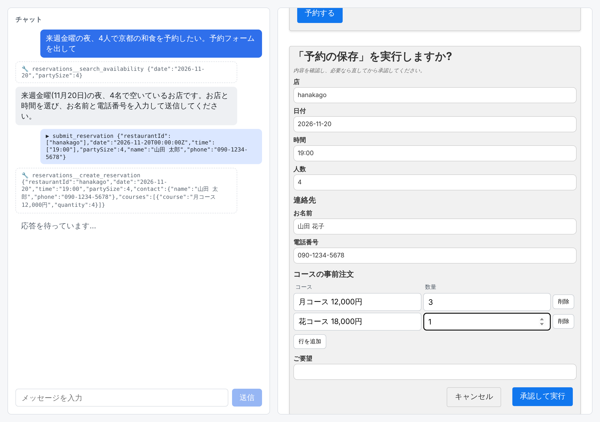

# example-a2ui

Claude Agent SDK(TypeScript)と [A2UI](https://github.com/a2ui-project/a2ui) v1.0 の React レンダラーをつないだ最小サンプルです。

チャットで依頼すると、Claude がフォームなどの UI を A2UI で返し、ブラウザ上で React が描画し、ボタン操作が次のユーザーメッセージとして Claude に戻ります。AG-UI や CopilotKit は使わず、サーバーとクライアントの間は SSE だけです。

予約の例では、Claude が MCP ツールで空き状況を調べてフォームを作り、予約を保存するツールを呼ぶと、実行の前に**承認フォーム**が出ます。ユーザーは値を直してから承認でき、直した値で SQLite に保存されます。



実際に動かした結果(動画・スクリーンショット・Claude の生出力・確認できたこと/未確認のこと)は [docs/VERIFICATION.md](docs/VERIFICATION.md) にあります。

## 起動手順

必要なもの: Node 26、pnpm 12([mise](https://mise.jdx.dev/) を使うなら `mise install` で両方入ります)。

```sh
pnpm install
export ANTHROPIC_API_KEY=...   # Claude Code にログイン済みの環境では不要
pnpm dev                       # server (http://127.0.0.1:8787) と client (http://localhost:5173) を起動
```

ブラウザで http://localhost:5173 を開き、たとえば次のように送ります。

- 来週金曜の夜、4人で京都の和食を予約したい。予約フォームを出して
- 架空の雑貨店の月別売上を表にして → この内容をスライド3枚にまとめて → HTMLのレポートにして → PDFで見せて → 折れ線グラフを画像で描いて

| 環境変数 | 既定値 | 意味 |
| --- | --- | --- |
| `A2UI_CHAT_MODEL` | `claude-sonnet-5-5` | サーバーが使うモデル |
| `A2UI_CHAT_DB` | `server/data/reservations.db` | 予約を保存する SQLite のファイル |
| `PORT` | `8787` | サーバーのポート(変えるときは `client/vite.config.ts` の proxy も変える) |
| `LOG_RAW` | なし | 値を入れると、Claude が出力した文字列(A2UI Express を含む)をサーバーの標準出力にそのまま流す |

## コマンド

| コマンド | 内容 |
| --- | --- |
| `pnpm dev` | server と client を起動 |
| `pnpm test` | 単体テスト(壊れた DSL が error の part になること、承認フォームの組み立て、予約の保存など。Claude は呼ばない) |
| `pnpm typecheck` / `pnpm lint` / `pnpm build` | 型チェック / Biome / client のビルド |
| `pnpm e2e [reservation\|documents]` | 起動中のアプリをヘッドレスの Chromium で操作し、動画・スクリーンショット・ダウンロードしたファイルを `docs/evidence/` に残す(本物の Claude を呼ぶ) |

`.claude/gate.yaml` は [feedback-gate](https://github.com/nonchan7720/claude-hook-gate) 用の品質ゲートです。編集の直後に変更した側の lint・型チェック・単体テストを、停止時に全体(lint・typecheck・test・build)を走らせます。

## 構成

```
server/                    Node + TypeScript(Node 26 が .ts をそのまま実行する)
  src/index.ts             POST /api/chat を受け、part を SSE で返す。会話ごとの状態を持つ。POST /api/approval で承認を受ける
  src/claude.ts            Agent SDK の query() を 1 ターン分呼び、text_delta とツール呼び出しを取り出す
  src/a2ui.ts              カタログの読み込み、promptSnippet、Claude の出力 → part(text / a2ui / error)
  src/document-catalog.ts  基本カタログに資料表示の 5 コンポーネントと明細の表入力を足したカタログ
  src/reservation-mcp.ts   予約の MCP サーバー(Agent SDK と同じプロセスで動く)
  src/reservations.ts      予約の保存(Node 組み込みの SQLite)
  src/approval.ts          ツールの入力スキーマから承認フォーム(A2UI)を組み立てる
client/                    Vite + React + TypeScript
  src/App.tsx              チャット欄と A2UI の描画領域。MessageProcessor と A2uiSurface
  src/api.ts               POST /api/chat の SSE を読む
  src/catalog/             資料表示のコンポーネントの React 実装
e2e/run.cjs                通しの確認(Playwright)
```

server と client は `package.json` を分けています。Claude Agent SDK は zod 4、A2UI は zod 3.25 を要求するためです。

### 1 ターンの流れ

1. client が `{ conversationId, message, capabilities }` を POST する。`capabilities` は `{ '1.0': { supportedCatalogIds: [...] } }`。
2. server が `generator.createProcessor(capabilities)` を作り、`processor.promptSnippet` を Agent SDK の `systemPrompt`(`claude_code` プリセットの `append`)に入れる。
3. `query()` を `includePartialMessages: true` で呼び、`stream_event` の `text_delta` を `processor.openStream()` の `feed()` に流す。最後に `close()`。組み込みツール(ファイル編集や Bash など)は `tools: []` で全部止めていて、使えるのは予約の MCP サーバーだけ。
4. `feed()` / `close()` が返した part を SSE の `part` イベントで送る。
5. client は `a2ui` の part を `MessageProcessor.processMessages()` に渡し、`text` の part をチャットに出す。
6. ボタンが押されると `onAction` が呼ばれ、client が `{ action: { name, surfaceId, context } }` を送る。server はそれを `[a2ui action] {…}` というユーザーメッセージにして Claude に渡す。
7. 同じ会話の続きでは、Agent SDK のセッションを `resume` し、A2UI の state(`processor.createState()`)を使い回す。

### MCP と承認フォーム

予約の MCP サーバー(`server/src/reservation-mcp.ts`)には 3 つのツールがあります。

| ツール | 内容 | 許可 |
| --- | --- | --- |
| `search_availability` | 日付と人数から、空いている店・時刻・コースを返す | 常に許可(`allowedTools`) |
| `list_reservations` | 保存済みの予約を返す | 常に許可 |
| `create_reservation` | 予約と、コースの明細を SQLite に保存する | 実行の前に承認フォーム(`canUseTool`) |

`create_reservation` が呼ばれると、次の順に進みます。

1. `canUseTool` が呼ばれ、server がツールの入力スキーマ(JSON Schema)と Claude が渡そうとした入力から、承認フォームの A2UI メッセージを組み立てて SSE で送る(`server/src/approval.ts`)。Claude はこのフォームを書かない。
2. ユーザーがフォームの値を直して「承認して実行」を押すと、client がその時点の値を `POST /api/approval` で送る。
3. 待っていた `canUseTool` が、直された値を `updatedInput` として返し、ツールがその値で実行される。「キャンセル」なら deny を返す。

フォームの作り方はスキーマで決まります。

| スキーマ | フォーム |
| --- | --- |
| `title` | 項目のラベル(無ければ引数名)。ツール全体の `title` はフォームの題 |
| 文字列・数値 / 真偽値 | `TextField` / `CheckBox` |
| オブジェクト(ネスト) | 見出し付きのグループ。中の項目も同じ規則で作る |
| オブジェクトの配列(明細) | `LineItems`: セルを編集でき、行を追加・削除できる表 |

ラベルは zod の `.meta({ title: 'お名前' })` で付けます。承認フォームを出すツールを増やすときは、`reservation-mcp.ts` の `APPROVAL_SCHEMAS` にツール名とスキーマを足します。enum の選択肢や入力チェック(必須・範囲)にはまだ対応していません。

### 資料表示のコンポーネント

基本カタログに無い表示を、カスタムカタログとして足しています。Claude は内容だけを書き、ファイルはブラウザの中で作ります(サーバーにツールは要りません)。

| コンポーネント | 表示 | ダウンロード |
| --- | --- | --- |
| `Table` | 表 | CSV、Excel(.xlsx) |
| `SlideDeck` | スライドの一覧 | PowerPoint(.pptx) |
| `HtmlReport` | HTML のレポート(sandbox の iframe) | .html |
| `PdfDocument` | その場で作った PDF を pdf.js で表示 | .pdf |
| `SvgImage` | Claude が SVG で描いた画像 | SVG、PNG |

このほかに、明細の表入力 `LineItems` があります(承認フォームが使います。Claude が自分のフォームで使うこともできます)。

コンポーネントを足すときは、`server/src/document-catalog.ts`(Claude に見せる定義)と `client/src/catalog/`(React 実装)の両方に同じ名前とプロパティで書きます。

## 自分のアプリに組み込むときの注意

- 会話の状態(セッション ID と A2UI の state)と、回答待ちの承認フォームはサーバーのメモリにあります。再起動で消え、複数プロセスでは共有されません。
- 承認フォームの回答を待っている間、そのターンの SSE は開いたままです。ブラウザを閉じると、そのツール呼び出しは待ったままになります(タイムアウトは入れていません)。
- 店とコースは `server/src/reservations.ts` に書いた架空のデータです。
- 認証もレート制限もありません。サーバーは 127.0.0.1 だけで待ち受けます。
- `HtmlReport` と `SvgImage` は Claude が書いた HTML / SVG を表示します。スクリプトが動かない形(sandbox の iframe + CSP、``)で表示していますが、公開するアプリではこの扱いを見直してください。
- PDF には日本語フォント(Noto Sans JP、約 5MB)を丸ごと埋め込むため、1 ファイル 3MB 強になります。
- バージョンはすべて `package.json` で固定しています。A2UI のパッケージは 0.x で、API が変わりやすい段階です。
