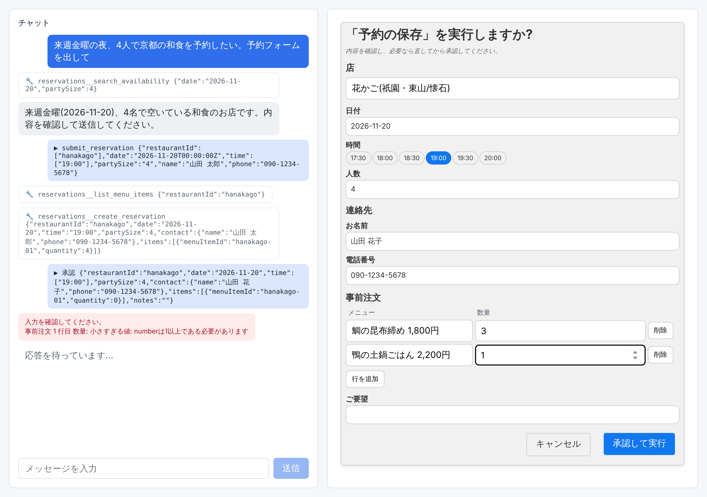

# example-a2ui

Claude Agent SDK(TypeScript)と [A2UI](https://github.com/a2ui-project/a2ui) v1.0 の React レンダラーをつないだ最小サンプルです。

チャットで依頼すると、Claude がフォームなどの UI を A2UI で返し、ブラウザ上で React が描画し、ボタン操作が次のユーザーメッセージとして Claude に戻ります。AG-UI や CopilotKit は使わず、サーバーとクライアントの間は SSE だけです。

予約の例では、Claude が MCP ツールで空き状況を調べてフォームを作り、予約を保存するツールを呼ぶと、実行の前に**承認フォーム**が出ます。ユーザーは値を直してから承認でき、直した値で SQLite に保存されます。



実際に動かした結果(動画・スクリーンショット・Claude の生出力・確認できたこと/未確認のこと)は [docs/VERIFICATION.md](docs/VERIFICATION.md) にあります。

## 起動手順

必要なもの: Node 26、pnpm 12([mise](https://mise.jdx.dev/) を使うなら `mise install` で両方入ります)。

```sh
pnpm install
export ANTHROPIC_API_KEY=...   # Claude Code にログイン済みの環境では不要
pnpm dev                       # server (http://127.0.0.1:8787) と client (http://localhost:5173) を起動
```

ブラウザで http://localhost:5173 を開き、たとえば次のように送ります。

- 来週金曜の夜、4人で京都の和食を予約したい。予約フォームを出して
- 架空の雑貨店の月別売上を表にして → この内容をスライド3枚にまとめて → HTMLのレポートにして → PDFで見せて → 折れ線グラフを画像で描いて

| 環境変数 | 既定値 | 意味 |
| --- | --- | --- |
| `A2UI_CHAT_MODEL` | `claude-sonnet-5-5` | 会話に使うモデル |
| `A2UI_CHAT_OPTIONS_MODEL` | `claude-haiku-5-5` | 選択肢の取得に使うモデル |
| `A2UI_CHAT_DB` | `server/data/reservations.db` | 予約を保存する SQLite のファイル |
| `PORT` | `8787` | サーバーのポート(変えるときは `client/vite.config.ts` の proxy も変える) |
| `LOG_RAW` | なし | 値を入れると、Claude が出力した文字列(A2UI Express を含む)をサーバーの標準出力にそのまま流す |

## コマンド

| コマンド | 内容 |
| --- | --- |
| `pnpm dev` | server と client を起動 |
| `pnpm test` | 単体テスト(壊れた DSL が error の part になること、承認フォームの組み立て、予約の保存とメニューのページ分けなど。Claude は呼ばない) |
| `pnpm typecheck` / `pnpm lint` / `pnpm build` | 型チェック / Biome / client のビルド |
| `pnpm e2e [reservation\|cancel\|documents]` | 起動中のアプリをヘッドレスの Chromium で操作し、動画・スクリーンショット・ダウンロードしたファイルを `docs/evidence/` に残す(本物の Claude を呼ぶ) |

`.claude/gate.yaml` は [feedback-gate](https://github.com/nonchan7720/claude-hook-gate) 用の品質ゲートです。編集の直後に変更した側の lint・型チェック・単体テストを、停止時に全体(lint・typecheck・test・build)を走らせます。

## 構成

サービスとして作るときの「アプリサーバー → エージェントランタイム → MCP サーバー → API サーバー」に合わせて、server を 4 つの層に分けています。このサンプルでは 1 つのプロセスですが、import は上から下への一方向だけで、アプリ層は MCP にも API(SQLite)にも直接は触りません。

```
server/src/                Node + TypeScript(Node 26 が .ts をそのまま実行する)
  app/                     アプリサーバー: ブラウザとの通信と、UI(A2UI)の組み立て
    index.ts               POST /api/chat(SSE)、/api/approval(承認の回答)、/api/options(選択肢の 1 ページ)
    a2ui.ts                カタログの読み込み、promptSnippet、Claude の出力 → part(text / a2ui / error)
    approval.ts            ツールの入力スキーマから承認フォーム(A2UI)を組み立てる
    document-catalog.ts    基本カタログに、資料表示と入力用のコンポーネントを足したカタログ
  agent/                   エージェントランタイム: Claude Agent SDK を呼ぶ。MCP につなぐのはここだけ
    claude.ts              会話の 1 ターン。text_delta とツール呼び出しを取り出し、canUseTool で承認を求める
    options.ts             選択肢を 1 ページ取る(Claude に選択肢のツールを呼ばせる)
  mcp/                     MCP サーバー
    reservation-mcp.ts     予約のツールと、その入力スキーマ
  api/                     API サーバーに当たる部分
    reservations.ts        予約とメニューの保存(Node 組み込みの SQLite)
client/                    Vite + React + TypeScript
  src/App.tsx              チャット欄と A2UI の描画領域。MessageProcessor と A2uiSurface
  src/api.ts               サーバーとの通信
  src/catalog/             カスタムコンポーネントの React 実装
e2e/run.cjs                通しの確認(Playwright)
```

server と client は `package.json` を分けています。Claude Agent SDK は zod 4、A2UI は zod 3.25 を要求するためです。

### 1 ターンの流れ

1. client が `{ conversationId, message, capabilities }` を POST する。`capabilities` は `{ '1.0': { supportedCatalogIds: [...] } }`。
2. server が `generator.createProcessor(capabilities)` を作り、`processor.promptSnippet` を Agent SDK の `systemPrompt`(`claude_code` プリセットの `append`)に入れる。
3. エージェント層が `query()` を `includePartialMessages: true` で呼び、`stream_event` の `text_delta` を `processor.openStream()` の `feed()` に流す。最後に `close()`。組み込みツール(ファイル編集や Bash など)は `tools: []` で全部止めていて、使えるのは予約の MCP サーバーだけ。
4. `feed()` / `close()` が返した part を SSE の `part` イベントで送る。
5. client は `a2ui` の part を `MessageProcessor.processMessages()` に渡し、`text` の part をチャットに出す。
6. ボタンが押されると `onAction` が呼ばれ、client が `{ action: { name, surfaceId, context } }` を送る。server はそれを `[a2ui action] {…}` というユーザーメッセージにして Claude に渡す。
7. 同じ会話の続きでは、Agent SDK のセッションを `resume` し、A2UI の state(`processor.createState()`)を使い回す。

### MCP と承認フォーム

予約の MCP サーバー(`server/src/mcp/reservation-mcp.ts`)のツール:

| ツール | 内容 | 許可 |
| --- | --- | --- |
| `search_availability` | 日付と人数から、空いている店と時刻を返す | 常に許可(`allowedTools`) |
| `list_restaurants` / `list_menu_items` | 店 / ある店のメニュー(24 品)を 1 ページずつ返す。検索と ID 指定ができる | 常に許可。フォームの選択肢にも使う |
| `list_reservations` | 保存済みの予約を返す | 常に許可 |
| `create_reservation` | 予約と、事前注文の明細を SQLite に保存する | 実行の前に承認フォーム(`canUseTool`) |

`create_reservation` が呼ばれると、次の順に進みます。

1. `canUseTool` が呼ばれ、アプリ層がツールの入力スキーマ(JSON Schema)と Claude が渡そうとした入力から、承認フォームの A2UI メッセージを組み立てて SSE で送る(`app/approval.ts`)。Claude はこのフォームを書かない。
2. ユーザーがフォームの値を直して「承認して実行」を押すと、client がその時点の値を `POST /api/approval` で送る。
3. 直された値を確かめる。まずツールのスキーマ(zod)で型・必須・範囲を、次に MCP 層の `check` でデータに照らした誤り(満席、店に無いメニュー)を見る。正しくなければ、どこが違うかをラベル付きで返し、フォームは開いたまま次の回答を待つ。
4. 正しければ、待っていた `canUseTool` がその値を `updatedInput` として返し、ツールがその値で実行される。「キャンセル」なら deny を返す。

フォームの作り方はスキーマで決まります。

| スキーマ | フォーム |
| --- | --- |
| `title` | 項目のラベル(無ければ引数名)。ツール全体の `title` はフォームの題 |
| 文字列・数値 / 真偽値 | `TextField` / `CheckBox` |
| enum | その場の選択肢(`ChoicePicker`)。表示名は `labels`(値 → 表示名) |
| `optionsFrom` | 別のツールから選択肢を取る欄(`Lookup`)。下の「選択肢を別のツールから取る」を参照 |
| 必須、`min` / `max`、文字数 | フォーム上のチェック。通らない間は承認ボタンを押せない |
| オブジェクト(ネスト) | 見出し付きのグループ。中の項目も同じ規則で作る |
| オブジェクトの配列(明細) | `LineItems`: セルを編集でき、行を追加・削除できる表。enum や `optionsFrom` の列は選択肢 |

これらは zod の `.meta({ title: 'お名前' })` のように付けます。承認フォームを出すツールを増やすときは、`reservation-mcp.ts` の `APPROVALS` にツール名とスキーマを足します。

### 選択肢を別のツールから取る

API を MCP にすると、フォームのデータを保存する API と、選択肢を返す API は別のツールになります。選択肢が多い項目は、スキーマに選択肢を埋め込まず、どのツールから取るかだけを書きます。

```ts
menuItemId: z.string().meta({
  title: 'メニュー',
  // 選ばれている店(フォームの restaurantId)のメニューを、list_menu_items から取る
  optionsFrom: { tool: 'list_menu_items', params: { restaurantId: 'restaurantId' } },
})
```

選択肢を返すツールは、入力に `query` / `cursor` / `limit` / `ids` を取り、`{ items: [{ id, name }], nextCursor? }` を返す約束です。

選択欄(`client/src/catalog/RemoteSelect.tsx`)は、開いたときに 1 ページ目を、下までスクロールすると `nextCursor` で続きを、検索語を入れると 1 ページ目から取り直します。選ばれている ID の表示名は `ids` で引きます。

取りに行く経路は「ブラウザ → `POST /api/options` → エージェント層 → Claude → MCP ツール」です。アプリ層は MCP を呼びません。エージェント層(`agent/options.ts`)は、そのツール 1 つだけを許可した短い `query()` を回して Claude に呼ばせ、ツールが返した結果(`tool_result`)をそのまま返します。Claude に結果を書き写させないので、内容が変わることはありません。

モデルを 1 回通すので、1 ページに約 3.5 秒かかります(`claude-haiku-5-5` での実測)。選択欄は取得中の表示を出し、同じ引数の結果は使い回し、検索は入力が止まってから送ります。もっと速くしたい場合は、エージェントランタイムがモデルを通さずに MCP ツールを呼ぶ形(Agent SDK には `mcp_call` という制御要求があるが、0.3.322 では公開されていない)が候補になります。

### 資料表示のコンポーネント

基本カタログに無い表示を、カスタムカタログとして足しています。Claude は内容だけを書き、ファイルはブラウザの中で作ります(サーバーにツールは要りません)。

| コンポーネント | 表示 | ダウンロード |
| --- | --- | --- |
| `Table` | 表 | CSV、Excel(.xlsx) |
| `SlideDeck` | スライドの一覧 | PowerPoint(.pptx) |
| `HtmlReport` | HTML のレポート(sandbox の iframe) | .html |
| `PdfDocument` | その場で作った PDF を pdf.js で表示 | .pdf |
| `SvgImage` | Claude が SVG で描いた画像 | SVG、PNG |

このほかに入力用のコンポーネントが 2 つあります。明細の表入力 `LineItems` と、ツールから選択肢を取る `Lookup` です(承認フォームが使います。Claude が自分のフォームで使うこともできます)。

コンポーネントを足すときは、`server/src/app/document-catalog.ts`(Claude に見せる定義)と `client/src/catalog/`(React 実装)の両方に同じ名前とプロパティで書きます。

## 自分のアプリに組み込むときの注意

- 会話の状態(セッション ID と A2UI の state)と、回答待ちの承認フォームはサーバーのメモリにあります。再起動で消え、複数プロセスでは共有されません。
- 承認フォームの回答を待っている間、そのターンの SSE は開いたままです。ブラウザを閉じると、そのツール呼び出しは待ったままになります(タイムアウトは入れていません)。
- 店とメニューは `server/src/api/reservations.ts` に書いた架空のデータです。
- `POST /api/options` は、選択肢のツール(`OPTION_TOOLS`)しか呼べないようにしてありますが、呼ぶたびにモデルの呼び出しが 1 回発生します。公開するアプリでは回数の制限が必要です。
- 認証もレート制限もありません。サーバーは 127.0.0.1 だけで待ち受けます。
- `HtmlReport` と `SvgImage` は Claude が書いた HTML / SVG を表示します。スクリプトが動かない形(sandbox の iframe + CSP、``)で表示していますが、公開するアプリではこの扱いを見直してください。
- PDF には日本語フォント(Noto Sans JP、約 5MB)を丸ごと埋め込むため、1 ファイル 3MB 強になります。
- バージョンはすべて `package.json` で固定しています。A2UI のパッケージは 0.x で、API が変わりやすい段階です。
