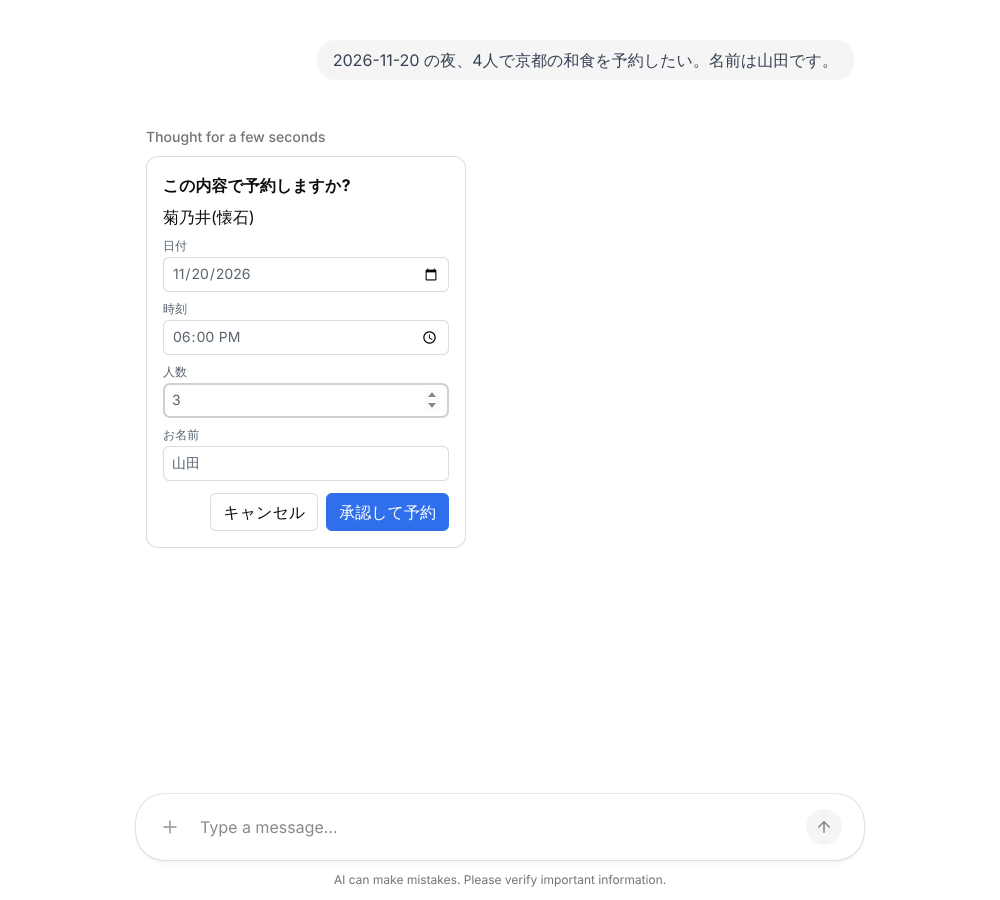

# CopilotKit × Claude Agent SDK(TypeScript)× Go ゲートウェイ

React の SPA に [CopilotKit](https://docs.copilotkit.ai/claude-sdk-typescript/) を入れ、Go のサーバーを挟んで Claude Agent SDK のエージェントにつなぐサンプルです。Human in the loop(実行前の承認)を入れてあります。

```
ブラウザ(web/: Vite + React + CopilotKit)
   │  /api/copilotkit/*   AG-UI のイベントが SSE で流れる
   ▼
Go ゲートウェイ(gateway/)        SPA の配信と、エージェントランタイムへの中継
   │  同じパスのまま中継(X-Agent-Token を付ける)
   ▼
エージェントランタイム(agent/)    CopilotKit ランタイム + ClaudeAgentAdapter + Claude Agent SDK
```



## 起動手順

必要なもの: Node 26、pnpm 12、Go 1.24 以上。

```sh
pnpm install                         # リポジトリのルートで
export ANTHROPIC_API_KEY=...         # Claude Code にログイン済みの環境では不要
pnpm dev:copilotkit                  # agent (http://127.0.0.1:8000) と web (http://localhost:5174)
(cd copilotkit/gateway && go run .)  # ゲートウェイ (http://127.0.0.1:8080)。別のターミナルで
```

http://localhost:5174 を開き、「来週金曜の夜、4人で京都の和食を予約したい。名前は山田です。」のように送ります。開発中も `/api` は Vite から Go のゲートウェイを通ります。

SPA をビルドすれば、Vite なしで Go だけがブラウザの相手をします。

```sh
pnpm --filter copilotkit-web build
(cd copilotkit/gateway && go run .)  # http://127.0.0.1:8080 で SPA も返す
```

`pnpm e2e:copilotkit` は、ビルドした SPA をヘッドレスの Chromium で操作し、証跡を `docs/evidence/copilotkit/` に残します(本物の Claude を呼びます)。

| 環境変数 | 既定値 | 使う側 | 意味 |
| --- | --- | --- | --- |
| `COPILOTKIT_AGENT_MODEL` | `claude-sonnet-5-5` | agent | 使うモデル |
| `AGENT_PORT` | `8000` | agent | エージェントランタイムのポート |
| `AGENT_URL` | `http://127.0.0.1:8000` | gateway | 中継先 |
| `GATEWAY_ADDR` | `127.0.0.1:8080` | gateway | 待ち受けるアドレス(変えるときは `web/vite.config.ts` の proxy も変える) |
| `STATIC_DIR` | `../web/dist` | gateway | SPA のビルド結果 |
| `AGENT_TOKEN` | なし | 両方 | 同じ値を両方に設定すると、ゲートウェイを通らないリクエストをエージェントランタイムが断る |

## 各部の役割

- `web/src/App.tsx`: `<CopilotKit runtimeUrl="/api/copilotkit">` と `<CopilotChat>`。`useHumanInTheLoop` で承認カードを登録する。
- `web/src/ReservationApproval.tsx`: 承認カード。Claude の提案を初期値にし、ユーザーが直して承認できる。
- `gateway/main.go`: 標準ライブラリだけの中継サーバー。`/api/copilotkit/` を中継し(SSE は溜めずに流す)、それ以外には SPA を返す。認証やレート制限を足す場所。
- `agent/src/server.ts`: `CopilotRuntime` に `ClaudeAgentAdapter` を登録し、`createCopilotNodeListener` で Node の HTTP サーバーにする。
- `agent/src/approval-gate.ts`: 承認された値でしか予約を保存させない仕組み(下の「承認の強制」)。
- `agent/src/reservations.ts`: 予約のツール(プロセス内 MCP サーバー、データは架空でメモリ上のみ)。

Go が中継するだけで済むのは、ブラウザとランタイムの間が普通の HTTP(JSON の POST と SSE の応答)だからです。CopilotKit のランタイムは Node のライブラリなので、Go に置き換えることはできず、エージェントランタイム側のプロセスに入れています。

## Human in the loop の流れ

Claude Agent SDK(TypeScript)の連携では、`useInterrupt`(割り込み)は使えません。承認は「ブラウザ側のツール」として作ります。

1. `useHumanInTheLoop` が `confirm_reservation` というツールを登録する。ツールの定義は実行のたびにランタイムへ送られ、アダプターが Claude に見せる。
2. Claude が `search_availability` で空きを調べ、`confirm_reservation` を呼ぶ。ここで実行が止まり、チャットの中に承認カードが出る。
3. ユーザーが値を直して「承認して予約」を押すと、`respond({ approved: true, ...値 })` がツールの結果として Claude に返り、実行が続く。
4. Claude が、返ってきた値で `create_reservation` を呼ぶ。

### 承認の強制(`canUseTool`)

カードを出すだけでは、「承認してから保存する」かどうかは Claude 次第です。そこで、Agent SDK の `canUseTool` でサーバー側から止めています(`agent/src/approval-gate.ts`)。

- `create_reservation` は常に許可するツール(`allowedTools`)に入れていないので、実行の前に `canUseTool` に来る。
- `confirm_reservation` の結果が Claude に返るところをエージェントランタイムが見て、`{"approved": true, ...}` なら、その値をスレッドごとに覚える。
- `canUseTool` は、覚えた承認が無ければ断る。あれば、Claude が書いた引数ではなく**承認された値**に入力を差し替えて(`updatedInput`)実行する。
- 承認は 1 回の保存で使い切る。キャンセルされたら、前の承認も取り消す。

`ClaudeAgentAdapter` には、ブラウザ側のツールの結果を見るための公開の口がありません。そのため `buildOptions` を上書きしたサブクラス(`GatedClaudeAgent`)にしています。アダプターの内部の作りに寄っているので、`@ag-ui/claude-agent-sdk` を上げるときは通しの確認が必要です。

## 確認したこと

本物の Claude 呼び出しで通しで動かした結果(動画・スクリーンショット・ログ・確認できたこと/未確認のこと)は [VERIFICATION.md](VERIFICATION.md) にあります。

- 値を直して承認 → 直した値で保存される
- キャンセル → 何も保存されない
- 承認を飛ばして保存のツールを直接呼ばせる → `canUseTool` が断る

## 注意

- CopilotKit のオンボーディング CLI(`npx copilotkit@latest onboard start`)は使わず、公開されているドキュメントとパッケージの型定義をもとに手で組み込みました。CLI が作る構成とは違う可能性があります。
- CopilotKit のランタイムは、既定で利用状況(テレメトリー)を送ります。`agent` の `dev` スクリプトでは `COPILOTKIT_TELEMETRY_DISABLED=true` で止めています。インストール統計を送る `@scarf/scarf` の postinstall も、`pnpm-workspace.yaml` で実行しない設定にしています。
- 会話と予約はエージェントランタイムのメモリにあります。再起動で消えます。
- `@ag-ui/claude-agent-sdk` は 0.0.9 で、Claude Agent SDK は 0.3.306 に固定されます(ルートのサンプルは 0.3.322)。
- 認証はありません。ゲートウェイもエージェントランタイムも 127.0.0.1 だけで待ち受けます。
