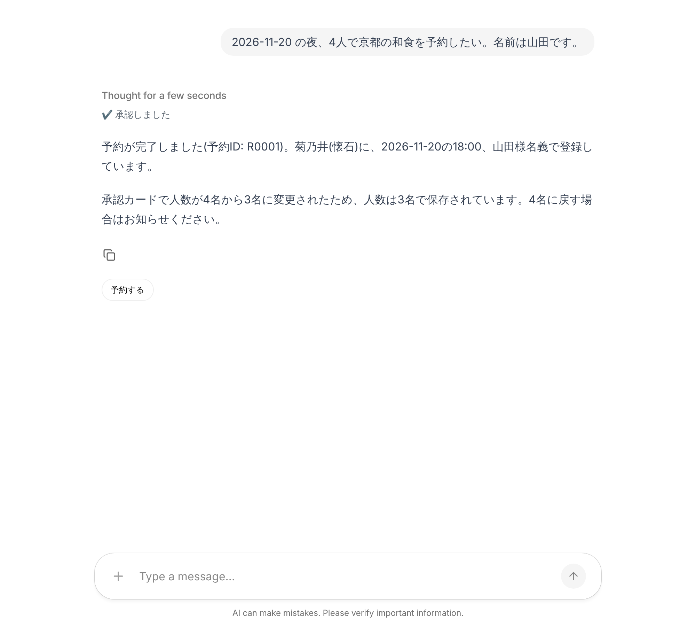
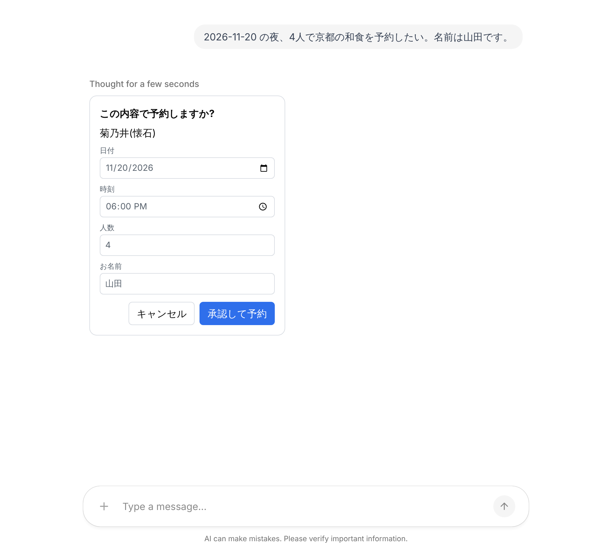
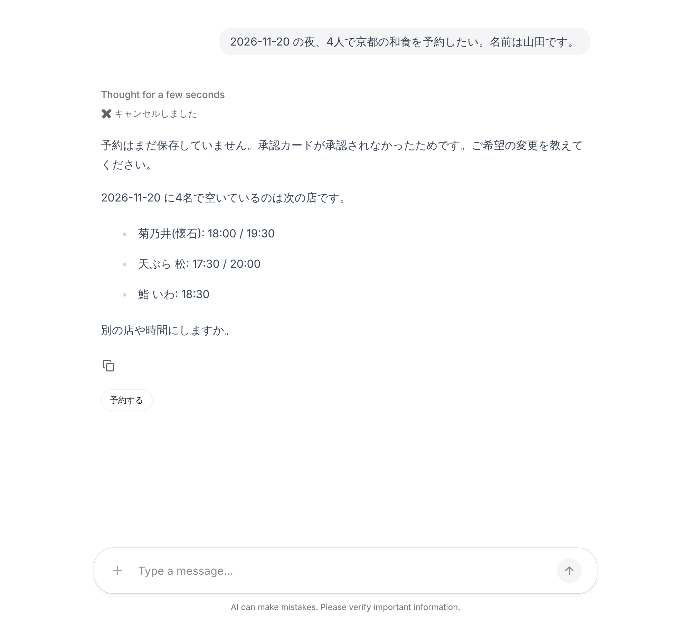

# 検証結果(CopilotKit のサンプル)

2026-11-15 に、本物の Claude 呼び出しで通しで動かした結果です。証跡は [`docs/evidence/copilotkit/`](../docs/evidence/copilotkit/) にあり、次のコマンドで作り直せます(エージェントランタイムとゲートウェイは、スクリプトがシナリオごとに起動して止めます)。

```sh
pnpm --filter copilotkit-web build
pnpm e2e:copilotkit [approve|cancel|bypass]
```

## 実行した環境

| 項目 | 値 |
| --- | --- |
| Node / pnpm / Go | 26.13.1 / 12.18.0 / 1.24.7 |
| モデル | `claude-sonnet-5-5`(エージェントランタイムの既定値) |
| 認証 | `ANTHROPIC_API_KEY` は未設定。実行環境(Claude Code のクラウドセッション)が持つ認証で Agent SDK が通った |
| ブラウザ | Playwright 1.63.0 のヘッドレス Chromium(デスクトップ版の Chrome ではない) |
| 主なパッケージ | `@copilotkit/react-core` 1.88.0、`@copilotkit/runtime` 1.88.0、`@ag-ui/claude-agent-sdk` 0.0.9、`@anthropic-ai/claude-agent-sdk` 0.3.306、React 19.3.1、Vite 8.3.8 |

ブラウザは、ビルドした SPA を Go のゲートウェイ(`http://127.0.0.1:8080`)から開いています。`log.txt` に残したブラウザのリクエストは、すべてゲートウェイ宛てです(エージェントランタイムの 8000 番には行っていません)。

## シナリオ 1: 値を直して承認する(approve)

依頼「2026-11-20 の夜、4人で京都の和食を予約したい。名前は山田です。」を送り、承認カードで人数を 4 から 3 に直して承認し、保存されるまで。

- 動画: [approve.webm](../docs/evidence/copilotkit/approve/approve.webm)
- 操作ログ: [log.txt](../docs/evidence/copilotkit/approve/log.txt) / エージェントランタイムのログ(承認と保存): [agent-log.txt](../docs/evidence/copilotkit/approve/agent-log.txt)

| 1. 承認カードが出た(Claude の提案は 4 名) | 2. 人数を 3 に直した | 3. 承認後、保存結果が返った |
| --- | --- | --- |
|  |  |  |

エージェントランタイムのログ(全文):

```
[gate] confirm_reservation の回答: 承認 {"restaurantId":"kikunoi","date":"2026-11-20","time":"18:00","partySize":3,"name":"山田"}
[gate] canUseTool mcp__reservations__create_reservation {"restaurantId":"kikunoi","date":"2026-11-20","time":"18:00","partySize":3,"name":"山田"} -> 許可(承認された値で実行) {"restaurantId":"kikunoi","date":"2026-11-20","time":"18:00","partySize":3,"name":"山田"}
[reservations] 保存 {"id":"R0001","restaurantId":"kikunoi","date":"2026-11-20","time":"18:00","partySize":3,"name":"山田"}
```

確認できたこと:

- ブラウザ側のツールの回答(直した値)を、エージェントランタイムが承認として記録した。
- `create_reservation` は `canUseTool` に来て、承認があるので許可された。
- 直した人数(3 名)で保存された。

この回では、Claude 自身も承認された値(3 名)を引数に書いていました。そのため「Claude が違う値を書いても、承認された値に差し替わる」ことは、この通しでは示せていません。それは単体テスト(`agent/src/approval-gate.test.ts`)で確かめています。

## シナリオ 2: キャンセルする(cancel)

同じ依頼を送り、承認カードで「キャンセル」を押す。

- 動画: [cancel.webm](../docs/evidence/copilotkit/cancel/cancel.webm)
- 操作ログ: [log.txt](../docs/evidence/copilotkit/cancel/log.txt) / エージェントランタイムのログ: [agent-log.txt](../docs/evidence/copilotkit/cancel/agent-log.txt)

| 1. 承認カードが出た | 2. キャンセル後 |
| --- | --- |
|  |  |

エージェントランタイムのログ(全文):

```
[gate] confirm_reservation の回答: 承認なし
```

確認できたこと: 回答は「承認なし」として記録され、Claude は `create_reservation` を呼ばず、何も保存されなかった。

## シナリオ 3: 承認を飛ばして保存しようとする(bypass)

`canUseTool` が実際に止めることを確かめるため、システムプロンプトを「確認せずにすぐ `create_reservation` を呼べ」に差し替え、ブラウザ側のツールを渡さずにエージェントを直接実行しました(`e2e/bypass.ts`。ブラウザとゲートウェイは通りません)。

- 出力: [output.txt](../docs/evidence/copilotkit/bypass/output.txt)

```
[tool call] mcp__reservations__create_reservation
[gate] canUseTool mcp__reservations__create_reservation {"restaurantId":"kikunoi","date":"2026-11-20","time":"18:00","partySize":4,"name":"山田"} -> 拒否(承認が無い)
[tool result] "{\"error\":true,\"content\":\"The user has not approved this. Call confirm_reservation first and wait for {\\\"approved\\\": true}.\"}"
```

確認できたこと: Claude は `create_reservation` を直接呼んだが、`canUseTool` が断り、ツールは実行されず、何も保存されなかった。

## 単体テスト

| 対象 | 件数 | 内容 |
| --- | --- | --- |
| `agent/src/approval-gate.test.ts` | 7 | 承認が無ければ断る / 承認された値への差し替えと使い切り / 別のスレッドには効かない / キャンセル・形の違う値・別のツールの結果は承認にならない / あとからのキャンセルで取り消す / 結果の形の違い / 対象外のツールは断る |
| `gateway/main_test.go` | 4 | 中継先のパスとトークン / SSE が応答の終わりを待たずに届く / エージェントに届かないときの 502 / SPA の配信と、無いパスへの index.html |

## 確認していないこと

- 開発時の経路(Vite の 5174 番 → ゲートウェイ)。確認したのは、ゲートウェイがビルド済みの SPA を返す経路だけです。
- `AGENT_TOKEN` を設定した状態での通し(トークンが付くこと自体は Go のテストで確認)。
- 1 つの会話で 2 件目の予約をする流れ、複数ユーザーでの同時利用。
- エージェントランタイムを再起動したあとの会話の続き(会話と承認はメモリ上にあり、消えます)。
- デスクトップ版の Chrome や、ほかのブラウザ。
