# 検証結果

2026-11-12 に、本物の Claude 呼び出しでアプリを通しで動かした結果です。証跡はすべて [`docs/evidence/`](evidence/) にあり、`pnpm e2e` で作り直せます。

## 実行した環境

| 項目 | 値 |
| --- | --- |
| Node / pnpm | 26.13.1 / 12.18.0 |
| モデル | `claude-sonnet-5-5`(サーバーの既定値) |
| 認証 | `ANTHROPIC_API_KEY` は未設定。実行環境(Claude Code のクラウドセッション)が持つ認証で Agent SDK が通った |
| ブラウザ | Playwright 1.63.0 のヘッドレス Chromium(デスクトップ版の Chrome ではない) |
| 主なパッケージ | `@anthropic-ai/claude-agent-sdk` 0.3.322、`@a2ui/agent` 0.1.0、`@a2ui/web_core` 0.15.0、`@a2ui/react` 0.15.0、`@a2ui/markdown-it` 0.2.2、React 19.3.1、Vite 8.3.8、TypeScript 7.0.2 |

## シナリオ 1: 予約(MCP + 承認フォーム + SQLite)

依頼「来週金曜の夜、4人で京都の和食を予約したい。予約フォームを出して」を送り、フォームを送信し、承認フォームで内容を直して承認し、SQLite に保存されるまで。

- 動画: [reservation.webm](evidence/reservation/reservation.webm)
- 操作ログ: [log.txt](evidence/reservation/log.txt) / Claude の生出力とツール呼び出し: [claude-output.txt](evidence/reservation/claude-output.txt)

| 1. MCP の空き状況からフォームが作られた | 2. 入力した | 3. 送信すると承認フォームが出た |
| --- | --- | --- |
| 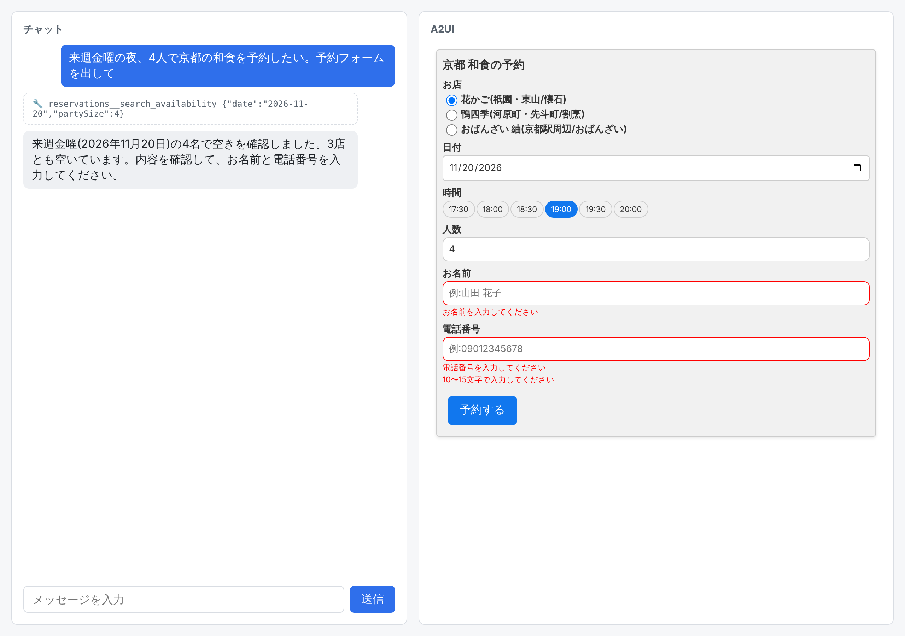 | 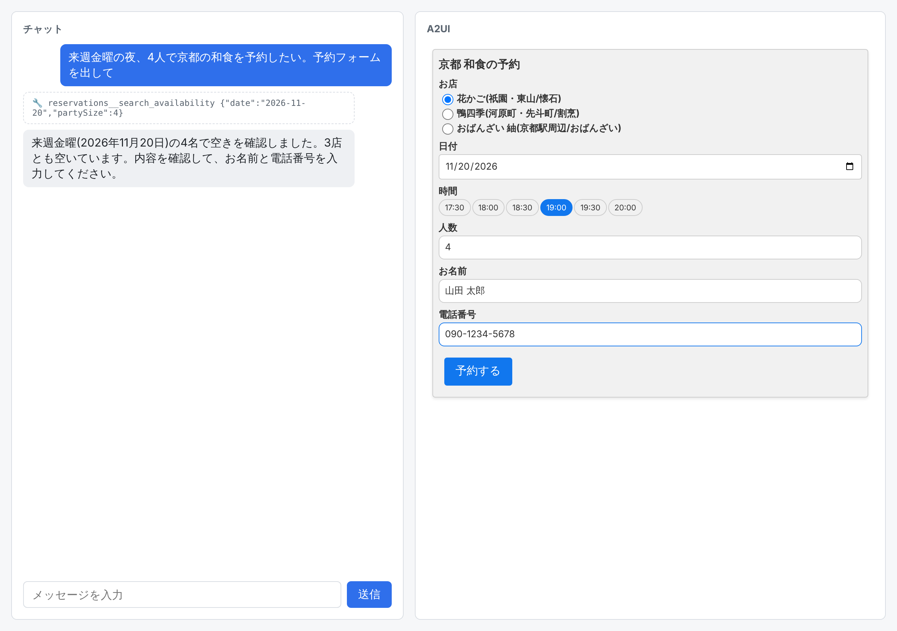 | 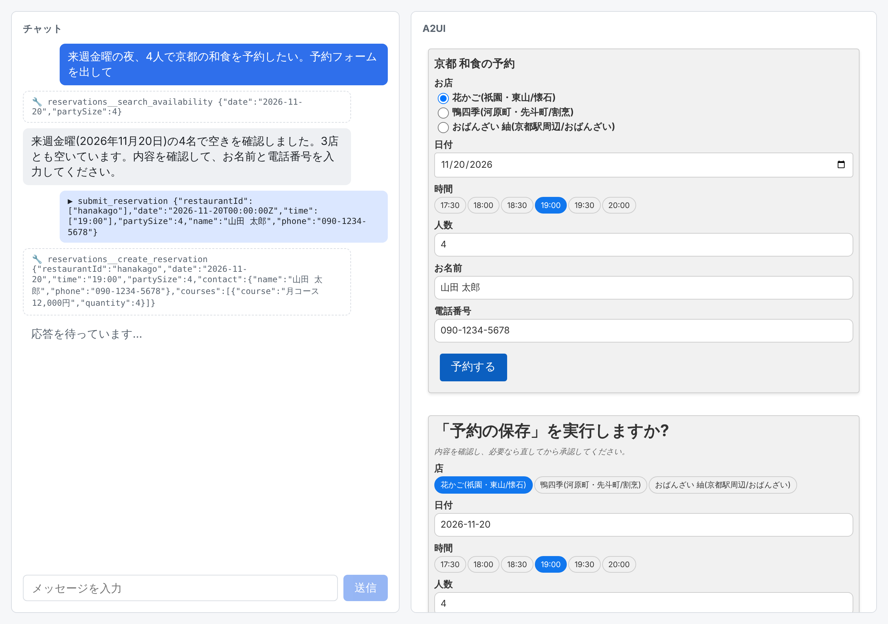 |

| 4. お名前を空にすると承認ボタンが押せない | 5. 数量 0 で承認すると理由が出て、フォームは開いたまま |
| --- | --- |
| 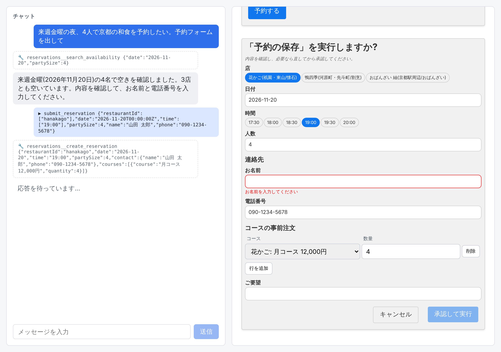 | 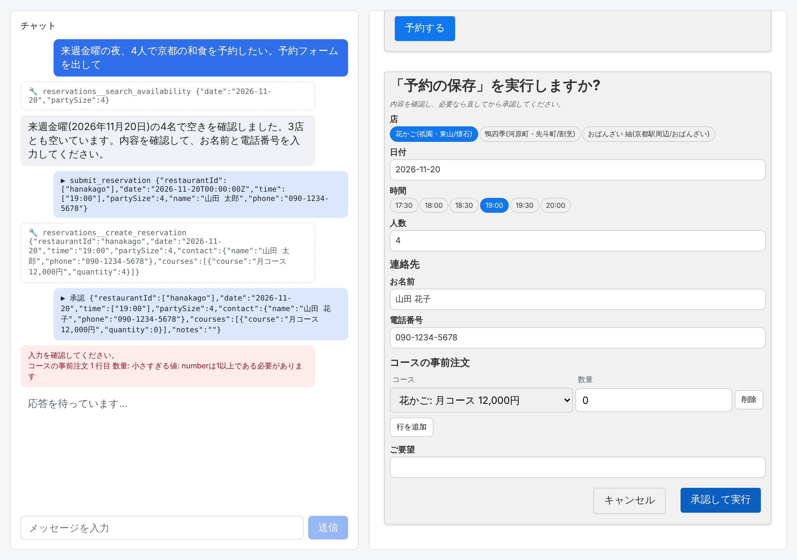 |

| 6. 名前と明細を直した | 7. 承認後、保存結果が返った |
| --- | --- |
| 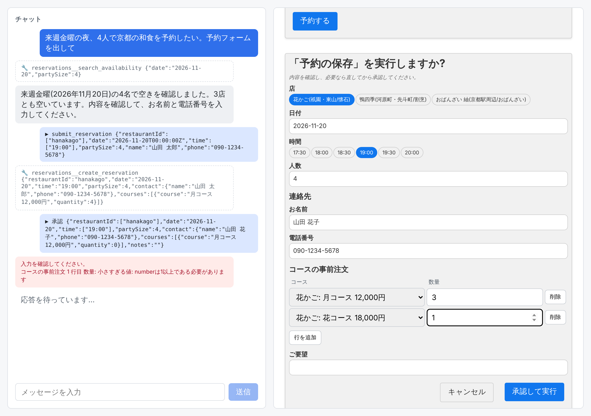 | 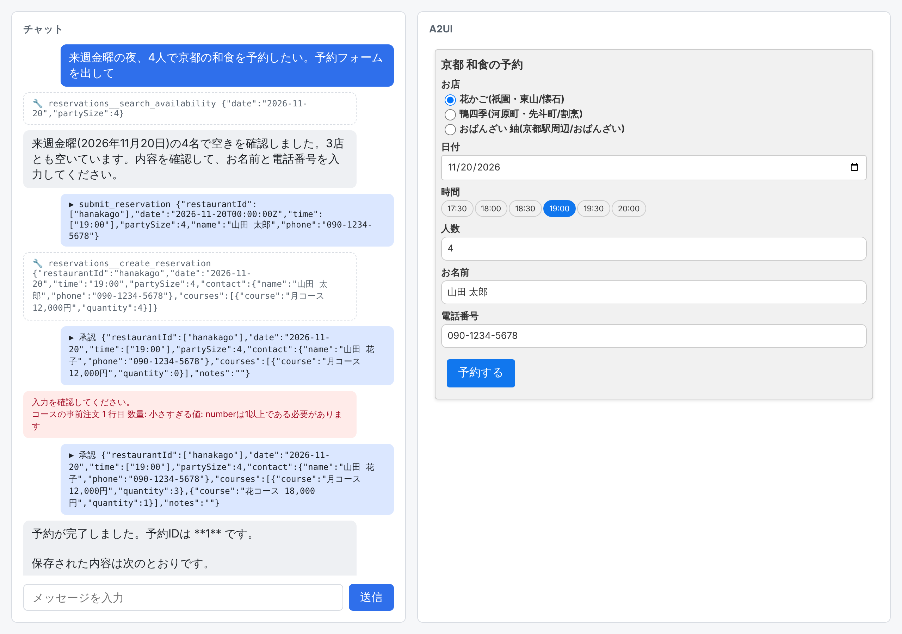 |

起きたことを順に(すべて実際のログから):

1. Claude が MCP ツールを呼んだ。

   ```
   [tool] mcp__reservations__search_availability {"date":"2026-11-20","partySize":4}
   ```

2. フォームの送信ボタンを押すと、アクションが Claude に戻った。

   ```
   [POST /api/chat] {"name":"submit_reservation","surfaceId":"reservation-form","context":{"restaurantId":["hanakago"],"date":"2026-11-20T00:00:00Z","time":["19:00"],"partySize":4,"name":"山田 太郎","phone":"090-1234-5678"}}
   ```

3. Claude が予約の保存ツールを呼んだ。この時点では実行されず、`canUseTool` が承認フォームを出して待つ。

   ```
   [tool] mcp__reservations__create_reservation {"restaurantId":"hanakago","date":"2026-11-20","time":"19:00","partySize":4,"contact":{"name":"山田 太郎","phone":"090-1234-5678"},"courses":[{"course":"月コース 12,000円","quantity":4}]}
   ```

4. 承認フォームは入力スキーマから作られた。「店」「時間」は名前で選ぶ選択肢、「連絡先」はグループ、「コースの事前注文」は表で、コースの列は選択肢。

5. 入力チェックを 2 通り確かめた。

   ```
   [check] お名前が空のとき、承認ボタンは押せない: true
   [check] 数量 0 で承認したときの表示: 入力を確認してください。 / コースの事前注文 1 行目 数量: 小さすぎる値: numberは1以上である必要があります
   ```

   1 つ目はフォーム上のチェック(A2UI の checks)、2 つ目は承認時にサーバーがツールのスキーマ(zod)で確かめた結果。

6. 「お名前」を 山田 太郎 → 山田 花子 に、「コースの事前注文」を 1 行(4 つ)→ 2 行(3 つと 1 つ)に直して承認した。ブラウザが送った回答:

   ```
   [POST /api/approval] {"surfaceId":"approval_adfffbaa515a442ea6ddba07ffbb86ac","approved":true,"input":{"restaurantId":["hanakago"],"date":"2026-11-20","time":["19:00"],"partySize":4,"contact":{"name":"山田 花子","phone":"090-1234-5678"},"courses":[{"course":"月コース 12,000円","quantity":3},{"course":"花コース 18,000円","quantity":1}],"notes":""}}
   ```

7. 直した値でツールが実行され、SQLite の 2 つのテーブルに保存された(e2e がデータベースを直接読んだ結果)。

   ```
   [sqlite] reservations: {"id":1,"restaurant_id":"hanakago","date":"2026-11-20","time":"19:00","party_size":4,"name":"山田 花子","phone":"090-1234-5678","notes":"","created_at":"2026-11-12 16:45:52"}
   [sqlite] reservation_courses: [{"course":"月コース 12,000円","quantity":3},{"course":"花コース 18,000円","quantity":1}]
   ```

### Claude が実際に出力した A2UI Express(1 ターン目のフォーム)

```
<a2ui>
surface("reservation-form")
$/form/restaurant = ["hanakago"]
$/form/date = "2026-11-20T00:00:00Z"
$/form/time = ["19:00"]
$/form/partySize = 4
$/form/name = ""
$/form/phone = ""
title = Text("**京都 和食の予約**")
restaurant = ChoicePicker("お店", "mutuallyExclusive", [{label: "花かご(祇園・東山/懐石)", value: "hanakago"}, {label: "鴨四季(河原町・先斗町/割烹)", value: "kamoshiki"}, {label: "おばんざい 紬(京都駅周辺/おばんざい)", value: "obanzai-tsumugi"}], $/form/restaurant)
date = DateTimeInput($/form/date, true, false, null, null, "日付")
time = ChoicePicker("時間", "mutuallyExclusive", [{label: "17:30", value: "17:30"}, {label: "18:00", value: "18:00"}, {label: "18:30", value: "18:30"}, {label: "19:00", value: "19:00"}, {label: "19:30", value: "19:30"}, {label: "20:00", value: "20:00"}], $/form/time, "chips")
party = TextField("人数", $/form/partySize, null, "number")
name = TextField("お名前", $/form/name, "例:山田 花子", "shortText", null, [?required("お名前を入力してください")])
phone = TextField("電話番号", $/form/phone, "例:09012345678", "shortText", null, [?required("電話番号を入力してください"), ?length(10, 15, "10〜15文字で入力してください")])
submitLabel = Text("予約する")
submit = Button(submitLabel, "primary", Event("submit_reservation", {restaurantId: $/form/restaurant, date: $/form/date, time: $/form/time, partySize: $/form/partySize, name: $/form/name, phone: $/form/phone}))
form = Column([title, restaurant, date, time, party, name, phone, submit])
root = Card(form)
(node:15383) [CLAUDE_SDK_CAN_USE_TOOL_SHADOWED] Warning: canUseTool will not be invoked for: mcp__reservations__search_availability, mcp__reservations__list_reservations. Bare allowedTools entries auto-approve the whole tool before the callback is consulted. To gate every tool call, use a PreToolUse hook; or remove the bare names from allowedTools so they fall through to canUseTool. Allow rules from settings files can also shadow the callback but are not visible here.
</a2ui>
```

## シナリオ 1b: 承認フォームでキャンセル(cancel)

同じ流れで承認フォームまで進め、「キャンセル」を押した。ツールは実行されず、予約は増えなかった。

- 動画: [cancel.webm](evidence/cancel/cancel.webm) / 操作ログ: [log.txt](evidence/cancel/log.txt)

| 承認フォーム | キャンセル後 |
| --- | --- |
| 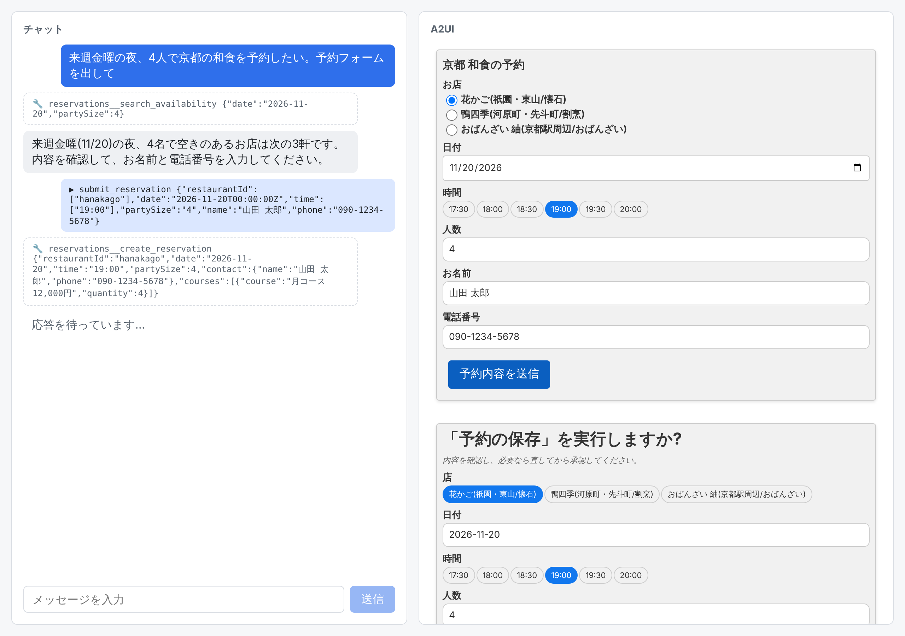 | 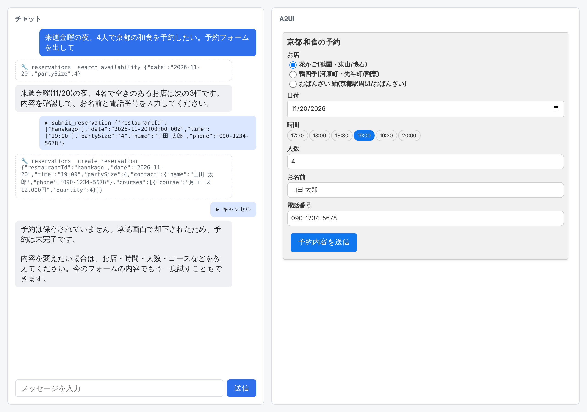 |

```
[POST /api/approval] {"surfaceId":"approval_aa31f1fe657748a9953c0d6d845d1c97","approved":false}
[sqlite] 最後の予約番号: キャンセル前 1 / キャンセル後 1
```

## シナリオ 2: 資料の表示(documents)

1 つの会話の中で、表 → スライド → HTML レポート → PDF → 画像の順に依頼し、それぞれのダウンロードボタンを押して保存したファイルを確かめた。

- 動画: [documents.webm](evidence/documents/documents.webm)
- 操作ログ: [log.txt](evidence/documents/log.txt) / Claude の生出力: [claude-output.txt](evidence/documents/claude-output.txt)

| 依頼 | 画面 | 保存されたファイルと確かめた内容 |
| --- | --- | --- |
| 架空の雑貨店の2026年4〜9月の月別売上(売上・客数・客単価)を表にして | 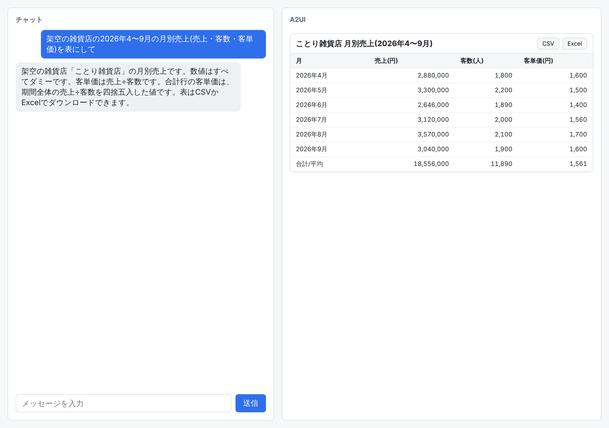 | `.csv`: 先頭行が列名、以降がデータ行。`.xlsx`: zip の中に `xl/worksheets/sheet1.xml` がある |
| この内容を社内報告用のスライド3枚にまとめて | 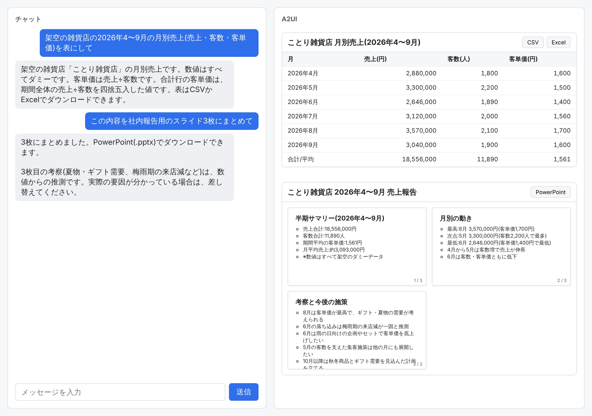 | `.pptx`: zip の中に `ppt/slides/slide1〜3.xml` がある |
| 同じ内容をHTMLのレポートにして。売上の棒グラフも入れて | 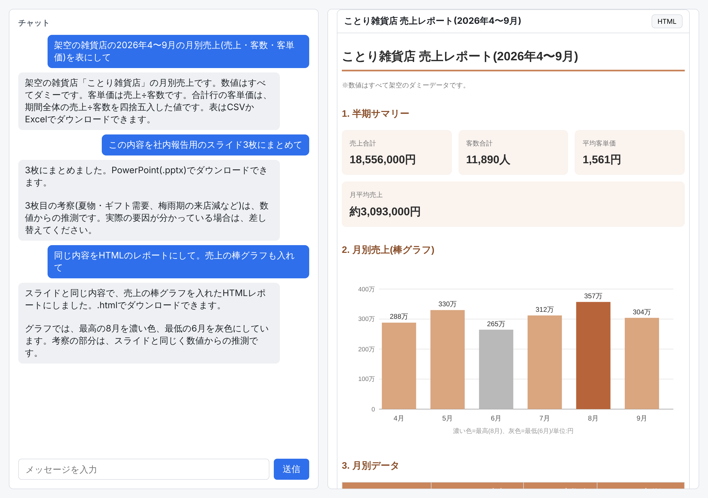 | `.html` |
| 同じ内容を1〜2ページの報告書にしてPDFで見せて | 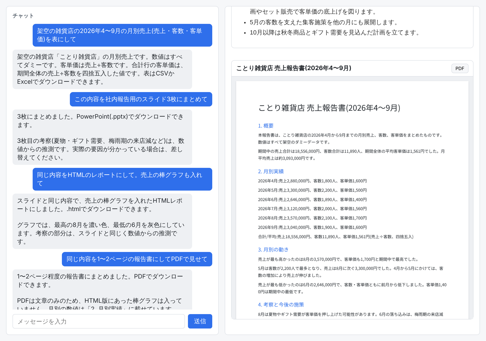 | `.pdf`: A4・1 ページ。`pdftotext` で日本語の本文を取り出せる |
| 売上の推移が一目でわかる折れ線グラフを画像で描いて | 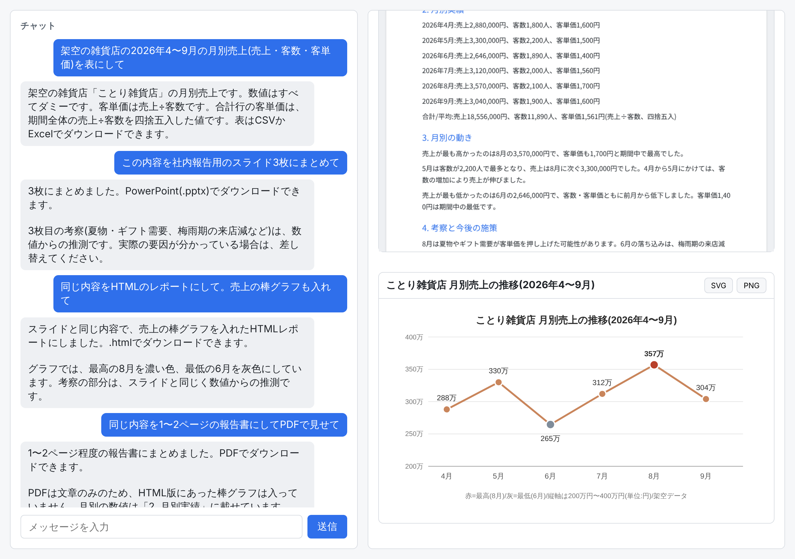 | `.svg` と `.png` |

保存されたファイルは [`docs/evidence/documents/`](evidence/documents/) にそのまま置いてある。

## 単体テスト(Claude を呼ばない)

`pnpm test` で 12 件すべて成功。

[`server/src/a2ui.test.ts`](../server/src/a2ui.test.ts):

- 正しい A2UI Express は `a2ui` の part になる
- **わざと壊した DSL を feed すると `error` の part が返り、後ろの text は読み続ける**
- カタログに無いコンポーネントは `error` の part になる
- 閉じタグが無いまま終わった応答は `close()` で `error` の part になる
- state を使い回すと、次のターンで既存の surface を `update=true` で書き換えられる。付けずに同じ ID を使うと拒否される
- 資料表示のカタログでは `Table` などを書ける。基本カタログだけのクライアントには拒否される

[`server/src/approval.test.ts`](../server/src/approval.test.ts):

- 承認フォームは、ラベル・選択肢・入力チェック・ネストした項目・明細の表を持ち、レンダラーの state に受け入れられる
- フォームから返った値は、ネストや明細の中までスキーマの型に合わせられる
- 直された値が正しくなければ、どこが違うかをフォームのラベルで言える

[`server/src/reservations.test.ts`](../server/src/reservations.test.ts):

- 予約を保存すると番号が返り、一覧に出る
- 席が埋まった時刻は空き状況から消え、それ以上は予約できない
- 存在しない店・時刻・コースは保存しない

## 確認できたこと(本物の Claude 呼び出し)

- 依頼 → Claude が A2UI Express を出力 → サーバーが検証して SSE で送る → React が描画、の一連の流れ
- フォームへの入力がデータモデルに入り、ボタンのアクション(`name`、`surfaceId`、`context`)が次のユーザーメッセージとして Claude に戻り、会話が続く
- Claude が MCP ツール(`search_availability`)の結果からフォームの選択肢と初期値を作る
- 書き込みをするツール(`create_reservation`)は `canUseTool` で止まり、入力スキーマから作った承認フォームが出る。項目名はスキーマの `title`、enum は表示名で選ぶ選択肢、ネストした `contact` は見出し付きのグループ、配列の `courses` は行を追加・削除できる表になる
- 入力チェック: 必須の欄を空にすると承認ボタンが押せない。明細の数量を 0 にして承認すると、サーバーが理由をラベル付きで返し、フォームは開いたまま直せる
- 承認フォームで「キャンセル」を押すと、ツールは実行されず、何も保存されない
- 承認フォームで直した値(ネストした項目と明細を含む)が `updatedInput` としてツールに渡り、SQLite に保存される
- 2 ターン目以降で Agent SDK のセッションが再開されている(Claude が前のターンの内容を踏まえて応答)
- 会話ごとの A2UI の state が使い回されている(サーバーが作った承認フォームも同じ state を通り、承認後に削除される)
- 組み込みツールが 1 つも渡っていない(MCP を足す前の構成で、`system/init` メッセージの `tools` が空配列であることを見た。MCP を足した後は再確認していない)
- カスタムカタログの 5 コンポーネントの描画と、CSV / xlsx / pptx / html / pdf / svg / png のダウンロード

## 未確認のこと

| 項目 | 理由 |
| --- | --- |
| `ANTHROPIC_API_KEY` での認証 | この環境にキーが無く、セッションの認証で動かしたため |
| 本物の Claude が壊れた DSL を出したときの `error` の part | 最終版の実行では Claude が壊れた DSL を出さなかった。単体テストでのみ確認。開発の途中では、Claude が既存の surface ID を作り直そうとして `Surface … already exists.` の `error` の part が画面に出たのを 1 回見ている(その証跡は残していない) |
| 承認フォームの対応範囲 | 文字列・数値・真偽値・enum・ネストしたオブジェクト・オブジェクトの配列まで。文字列の配列、配列の中の配列、項目どうしの依存(店を変えたらコースの選択肢を絞る、など)は未実装。店に合わないコースを選んだ場合は、ツールがエラーを返し、Claude がそれを伝える(この経路は実呼び出しでは動かしていない) |
| 明細の行ごとのフォーム上のチェック | 明細の中の値は、承認を押した後にサーバーが確かめる。押す前に行の中で赤く表示する作りにはしていない |
| 外部プロセスの MCP サーバー(stdio / HTTP) | 予約の MCP サーバーは Agent SDK と同じプロセスの中で動く(`createSdkMcpServer`)。外部サーバーをつなぐ形は試していない |
| xlsx / pptx を Excel / PowerPoint で開くこと | この環境に Office が無い。zip の構造と中の文字列を確かめたところまで |
| デスクトップ版の Chrome での表示 | ヘッドレスの Chromium でのみ実行した |
| feedback-gate のフックから `gate.yaml` が実際に走ること | スキーマ(`scripts/gate.schema.json`)での検証と、書いたコマンドを 1 つずつ手で実行して成功するところまで |
| 最新の Playwright(1.65.0)での録画 | この環境に入っているブラウザと ffmpeg が 1.63.0 用で、1.65.0 では動画が書き出されなかった。そのため 1.63.0 に固定している |
| 既定以外のモデルでの通し確認 | 通しの確認は `claude-sonnet-5-5` のみ。他のモデルは下の「モデルによる違い」の範囲 |

## 「確認済みの事実」と違っていた点・追加で分かったこと

指定された事実のうち、import の場所、capabilities のキー `'1.0'`、既定の生成形式が A2UI Express であることは、インストールした版でそのとおりだった。違っていた点と、書かれていなかった点は次のとおり。

1. **`@a2ui/markdown-it` 0.2.2 の peer 指定が合わない。** peer に `@a2ui/web_core@^0.14.0` を指定しており、`@a2ui/web_core` 0.15.0 とは一緒にインストールできない(`@a2ui/react` 0.15.0 自身は markdown-it 0.2.2 と web_core 0.15 の両方に依存している)。`pnpm-workspace.yaml` の `overrides` で合わせた。
2. **`error` の part は既定では返らない。** `processor.openStream()` は既定だと、拒否したブロックで例外を投げてストリームを終える。`error` の part を受け取るには `openStream({ afterRejectedBlock: 'continue' })` が要る。また、拒否される前に読めた行のメッセージ(`createSurface` など)は先に届く。
3. **capabilities のキーは `'v1.0'` でもエラーになる。** `MessageProcessor.getRendererCapabilities({ versions: ['v1.0'] })` はキー `'v1.0'` のオブジェクトを返すが、`@a2ui/agent` はそれを受け付けない(`'v1_0'` と同じエラー)。`'1.0'` を渡すと `'1.0'` で返るので、使うならそちら。
4. **state を使い回すと、同じ surface ID の作り直しが拒否される。** `surface("id")` + `root = …` は `createSurface` にコンパイルされ、すでにある ID だと `Surface … already exists.` になる。既存の surface を書き換える構文 `surface("id", update=true)` はコンパイラにあるが、`promptSnippet` には説明が無い。サーバーのプロンプト(`server/src/claude.ts`)に説明を足した。
5. **Icon はフォントが無いと文字で出る。** 基本カタログの `Icon` は Material Icons のフォント名を指定するだけで、フォント自体は読み込まない。`material-icons` パッケージを足した。
6. **`basicCatalog` に React のコンポーネントを足すには `new Catalog<ReactCatalogComponent>(…)` が要る。** `basicCatalog.derive()` は型が Web Component 用で、React 実装を渡せない。
7. **コンポーネントの ID は識別子でなければならない。** `field-name` のようにハイフンを含む ID は `must be a valid UAX #31 identifier` で拒否される。
8. **サーバーが自分で作った A2UI メッセージは `RendererState.apply()` に通せる。** Claude の出力と同じ state で検証・記録されるので、承認フォームのようにサーバーが直接出す UI も整合が保てる。
9. **`pdf-lib` で `subset: true` にすると Noto Sans JP の文字の大半が欠ける。** フォント全体を埋め込んでいる。

## モデルによる違い

最初はモデルを指定せず、実行環境の既定(`claude-fable-5-2`)で動かしていた。その間に次のことが起きた。

- 応答が UI ではなく `Today is 2026-11-12.` や git status 風の文だけで終わる、または応答の先頭にそうした文や下書きの計算が混ざる
- 応答の途中で API がエラーを返す(`Fable 5.2's safeguards flagged this message … [reasoning_extraction]`)

同じ依頼(予約フォーム)を 1 ターンだけ並列に流して比べた結果:

| モデル | 結果 |
| --- | --- |
| `claude-fable-5-2` | 4 回中 3 回は UI を返し、1 回は上の API エラー |
| `claude-sonnet-5-5` | 6 回中 6 回 UI を返した |
| `claude-opus-5-5` | 6 回中 6 回 UI を返した |

回数が少ないので割合としては当てにならないが、この結果からサーバーの既定を `claude-sonnet-5-5` にし、`A2UI_CHAT_MODEL` で変えられるようにした。API がエラーを返した場合、アプリはそれを `error` の part としてチャットに表示する。

## 「すべて最新」から外したもの

| パッケージ | 固定した版 | 最新 | 理由 |
| --- | --- | --- | --- |
| `zod`(client) | 3.25.76 | 4.6.7 | `@a2ui/react` と `@a2ui/web_core` が zod 3.25 を要求する |
| `playwright` | 1.63.0 | 1.65.0 | 上の「未確認のこと」のとおり、この環境では 1.65.0 で録画できない |

`@biomejs/biome` 2.6.7 は公開から日が浅く、pnpm の既定の待機期間(`minimumReleaseAge`)に掛かったため、pnpm が `pnpm-workspace.yaml` の `minimumReleaseAgeExclude` に自動で追加した。

`pnpm audit` には high が 3 件残っている: `pptxgenjs` が使う `image-size`(2 件)と、client の `zod` 3.25(1 件)。どちらも依存元が新しい版に対応していないため直していない。
