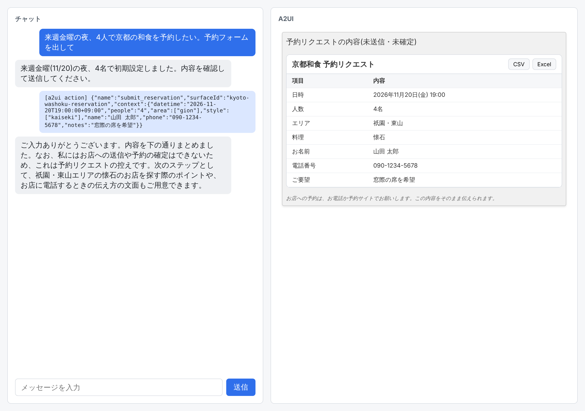

# 検証結果

2026-11-12 に、本物の Claude 呼び出しでアプリを通しで動かした結果です。証跡はすべて [`docs/evidence/`](evidence/) にあり、`pnpm e2e` で作り直せます。

## 実行した環境

| 項目 | 値 |
| --- | --- |
| Node / pnpm | 26.13.1 / 12.18.0 |
| モデル | `claude-sonnet-5-5`(サーバーの既定値) |
| 認証 | `ANTHROPIC_API_KEY` は未設定。実行環境(Claude Code のクラウドセッション)が持つ認証で Agent SDK が通った |
| ブラウザ | Playwright 1.63.0 のヘッドレス Chromium(デスクトップ版の Chrome ではない) |
| 主なパッケージ | `@anthropic-ai/claude-agent-sdk` 0.3.322、`@a2ui/agent` 0.1.0、`@a2ui/web_core` 0.15.0、`@a2ui/react` 0.15.0、`@a2ui/markdown-it` 0.2.2、React 19.3.1、Vite 8.3.8、TypeScript 7.0.2 |

## シナリオ 1: 予約フォーム(reservation)

依頼「来週金曜の夜、4人で京都の和食を予約したい。予約フォームを出して」を送り、フォームに入力して送信し、次の応答を受け取るまで。

- 動画: [reservation.webm](evidence/reservation/reservation.webm)
- 操作ログ: [log.txt](evidence/reservation/log.txt) / Claude の生出力: [claude-output.txt](evidence/reservation/claude-output.txt)

| フォームが描画された | 入力した | 送信後、Claude の次の応答 |
| --- | --- | --- |
|  |  |  |

ボタンを押したときに Claude へ戻ったメッセージ(ブラウザが実際に POST したもの):

```
[a2ui action] {"name":"submit_reservation","surfaceId":"kyoto-washoku-reservation","context":{"datetime":"2026-11-20T19:00:00+09:00","people":"4","area":["gion"],"style":["kaiseki"],"name":"山田 太郎","phone":"090-1234-5678","notes":"窓際の席を希望"}}
```

### Claude が実際に出力した A2UI Express(1 ターン目)

```
<a2ui>
surface("kyoto-washoku-reservation")
$/form/datetime = "2026-11-20T19:00:00+09:00"
$/form/people = "4"
$/form/area = ["any"]
$/form/style = ["kaiseki"]
$/form/name = ""
$/form/phone = ""
$/form/notes = ""

title = Text("京都の和食 予約フォーム")
sub = Text("来週金曜・夜・4名で仮入力しています。必要に応じて変更してください。", "caption")
dt = DateTimeInput($/form/datetime, true, true, null, null, "日時", checks=[?required($/form/datetime, "日時を入力してください")])
people = TextField("人数", $/form/people, "4", "number", checks=[?required($/form/people, "人数を入力してください"), ?numeric($/form/people, 1, 20, "1〜20名で入力してください")])
area = ChoicePicker("エリア", "mutuallyExclusive", [{label: "おまかせ", value: "any"}, {label: "祇園・東山", value: "gion"}, {label: "河原町・先斗町", value: "kawaramachi"}, {label: "嵐山", value: "arashiyama"}, {label: "京都駅周辺", value: "station"}], $/form/area, "chips")
style = ChoicePicker("料理のスタイル", "mutuallyExclusive", [{label: "懐石", value: "kaiseki"}, {label: "割烹・カウンター", value: "kappo"}, {label: "おばんざい", value: "obanzai"}, {label: "湯豆腐・豆腐料理", value: "tofu"}], $/form/style, "chips")
name = TextField("お名前", $/form/name, "例:山田 太郎", "shortText", checks=[?required($/form/name, "お名前を入力してください")])
phone = TextField("電話番号", $/form/phone, "090-1234-5678", "shortText", checks=[?required($/form/phone, "電話番号を入力してください"), ?regex($/form/phone, "^[0-9+\\-]{10,15}$", "電話番号の形式を確認してください")])
notes = TextField("ご要望・アレルギーなど", $/form/notes, "個室希望、アレルギー、記念日など", "longText")
btnText = Text("この内容で予約リクエストを送る")
submit = Button(btnText, "primary", Event("submit_reservation", {datetime: $/form/datetime, people: $/form/people, area: $/form/area, style: $/form/style, name: $/form/name, phone: $/form/phone, notes: $/form/notes}))
form = Column([title, sub, dt, people, area, style, name, phone, notes, submit])
root = Card(form)
</a2ui>
```

## シナリオ 2: 資料の表示(documents)

1 つの会話の中で、表 → スライド → HTML レポート → PDF → 画像の順に依頼し、それぞれのダウンロードボタンを押して保存したファイルを確かめた。

- 動画: [documents.webm](evidence/documents/documents.webm)
- 操作ログ: [log.txt](evidence/documents/log.txt) / Claude の生出力: [claude-output.txt](evidence/documents/claude-output.txt)

| 依頼 | 画面 | 保存されたファイルと確かめた内容 |
| --- | --- | --- |
| 架空の雑貨店の2026年4〜9月の月別売上(売上・客数・客単価)を表にして |  | `.csv`: 先頭行が列名、以降がデータ行。`.xlsx`: zip の中に `xl/worksheets/sheet1.xml` がある |
| この内容を社内報告用のスライド3枚にまとめて |  | `.pptx`: zip の中に `ppt/slides/slide1〜3.xml` がある |
| 同じ内容をHTMLのレポートにして。売上の棒グラフも入れて |  | `.html` |
| 同じ内容を1〜2ページの報告書にしてPDFで見せて |  | `.pdf`: A4・1 ページ。`pdftotext` で日本語の本文を取り出せる |
| 売上の推移が一目でわかる折れ線グラフを画像で描いて |  | `.svg` と `.png` |

保存されたファイルは [`docs/evidence/documents/`](evidence/documents/) にそのまま置いてある。

## 単体テスト(Claude を呼ばない)

`pnpm test` で 6 件すべて成功。[`server/src/a2ui.test.ts`](../server/src/a2ui.test.ts)

- 正しい A2UI Express は `a2ui` の part になる
- **わざと壊した DSL を feed すると `error` の part が返り、後ろの text は読み続ける**
- カタログに無いコンポーネントは `error` の part になる
- 閉じタグが無いまま終わった応答は `close()` で `error` の part になる
- state を使い回すと、次のターンで既存の surface を `update=true` で書き換えられる。付けずに同じ ID を使うと拒否される
- 資料表示のカタログでは `Table` などを書ける。基本カタログだけのクライアントには拒否される

## 確認できたこと(本物の Claude 呼び出し)

- 依頼 → Claude が A2UI Express を出力 → サーバーが検証して SSE で送る → React が描画、の一連の流れ
- フォームへの入力がデータモデルに入り、ボタンのアクション(`name`、`surfaceId`、`context`)が次のユーザーメッセージとして Claude に戻り、会話が続く
- 2 ターン目以降で Agent SDK のセッションが再開されている(Claude が前のターンの内容を踏まえて応答)
- 会話ごとの A2UI の state が使い回されている(2 ターン目に、1 ターン目のフォームが要約の表示に置き換わった)
- 組み込みツールが 1 つも渡っていない(`system/init` メッセージの `tools` が空配列)
- カスタムカタログの 5 コンポーネントの描画と、CSV / xlsx / pptx / html / pdf / svg / png のダウンロード

## 未確認のこと

| 項目 | 理由 |
| --- | --- |
| `ANTHROPIC_API_KEY` での認証 | この環境にキーが無く、セッションの認証で動かしたため |
| 本物の Claude が壊れた DSL を出したときの `error` の part | 最終版の実行では Claude が壊れた DSL を出さなかった。単体テストでのみ確認。開発の途中では、Claude が既存の surface ID を作り直そうとして `Surface … already exists.` の `error` の part が画面に出たのを 1 回見ている(その証跡は残していない) |
| xlsx / pptx を Excel / PowerPoint で開くこと | この環境に Office が無い。zip の構造と中の文字列を確かめたところまで |
| デスクトップ版の Chrome での表示 | ヘッドレスの Chromium でのみ実行した |
| feedback-gate のフックから `gate.yaml` が実際に走ること | スキーマ(`scripts/gate.schema.json`)での検証と、書いたコマンドを 1 つずつ手で実行して成功するところまで |
| 最新の Playwright(1.65.0)での録画 | この環境に入っているブラウザと ffmpeg が 1.63.0 用で、1.65.0 では動画が書き出されなかった。そのため 1.63.0 に固定している |
| 既定以外のモデルでの通し確認 | 通しの確認は `claude-sonnet-5-5` のみ。他のモデルは下の「モデルによる違い」の範囲 |

## 「確認済みの事実」と違っていた点・追加で分かったこと

指定された事実のうち、import の場所、capabilities のキー `'1.0'`、既定の生成形式が A2UI Express であることは、インストールした版でそのとおりだった。違っていた点と、書かれていなかった点は次のとおり。

1. **`@a2ui/markdown-it` 0.2.2 の peer 指定が合わない。** peer に `@a2ui/web_core@^0.14.0` を指定しており、`@a2ui/web_core` 0.15.0 とは一緒にインストールできない(`@a2ui/react` 0.15.0 自身は markdown-it 0.2.2 と web_core 0.15 の両方に依存している)。`pnpm-workspace.yaml` の `overrides` で合わせた。
2. **`error` の part は既定では返らない。** `processor.openStream()` は既定だと、拒否したブロックで例外を投げてストリームを終える。`error` の part を受け取るには `openStream({ afterRejectedBlock: 'continue' })` が要る。また、拒否される前に読めた行のメッセージ(`createSurface` など)は先に届く。
3. **capabilities のキーは `'v1.0'` でもエラーになる。** `MessageProcessor.getRendererCapabilities({ versions: ['v1.0'] })` はキー `'v1.0'` のオブジェクトを返すが、`@a2ui/agent` はそれを受け付けない(`'v1_0'` と同じエラー)。`'1.0'` を渡すと `'1.0'` で返るので、使うならそちら。
4. **state を使い回すと、同じ surface ID の作り直しが拒否される。** `surface("id")` + `root = …` は `createSurface` にコンパイルされ、すでにある ID だと `Surface … already exists.` になる。既存の surface を書き換える構文 `surface("id", update=true)` はコンパイラにあるが、`promptSnippet` には説明が無い。サーバーのプロンプト(`server/src/claude.ts`)に説明を足した。
5. **Icon はフォントが無いと文字で出る。** 基本カタログの `Icon` は Material Icons のフォント名を指定するだけで、フォント自体は読み込まない。`material-icons` パッケージを足した。
6. **`basicCatalog` に React のコンポーネントを足すには `new Catalog<ReactCatalogComponent>(…)` が要る。** `basicCatalog.derive()` は型が Web Component 用で、React 実装を渡せない。
7. **`pdf-lib` で `subset: true` にすると Noto Sans JP の文字の大半が欠ける。** フォント全体を埋め込んでいる。

## モデルによる違い

最初はモデルを指定せず、実行環境の既定(`claude-fable-5-2`)で動かしていた。その間に次のことが起きた。

- 応答が UI ではなく `Today is 2026-11-12.` や git status 風の文だけで終わる、または応答の先頭にそうした文や下書きの計算が混ざる
- 応答の途中で API がエラーを返す(`Fable 5.2's safeguards flagged this message … [reasoning_extraction]`)

同じ依頼(予約フォーム)を 1 ターンだけ並列に流して比べた結果:

| モデル | 結果 |
| --- | --- |
| `claude-fable-5-2` | 4 回中 3 回は UI を返し、1 回は上の API エラー |
| `claude-sonnet-5-5` | 6 回中 6 回 UI を返した |
| `claude-opus-5-5` | 6 回中 6 回 UI を返した |

回数が少ないので割合としては当てにならないが、この結果からサーバーの既定を `claude-sonnet-5-5` にし、`A2UI_CHAT_MODEL` で変えられるようにした。API がエラーを返した場合、アプリはそれを `error` の part としてチャットに表示する。

## 「すべて最新」から外したもの

| パッケージ | 固定した版 | 最新 | 理由 |
| --- | --- | --- | --- |
| `zod`(client) | 3.25.76 | 4.6.7 | `@a2ui/react` と `@a2ui/web_core` が zod 3.25 を要求する |
| `playwright` | 1.63.0 | 1.65.0 | 上の「未確認のこと」のとおり、この環境では 1.65.0 で録画できない |

`@biomejs/biome` 2.6.7 は公開から日が浅く、pnpm の既定の待機期間(`minimumReleaseAge`)に掛かったため、pnpm が `pnpm-workspace.yaml` の `minimumReleaseAgeExclude` に自動で追加した。

`pnpm audit` には high が 3 件残っている: `pptxgenjs` が使う `image-size`(2 件)と、client の `zod` 3.25(1 件)。どちらも依存元が新しい版に対応していないため直していない。
